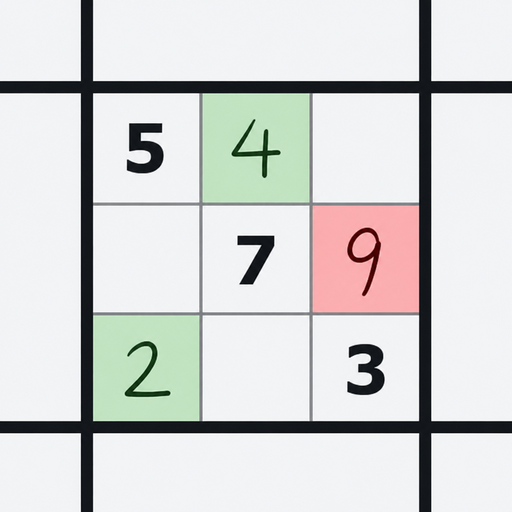
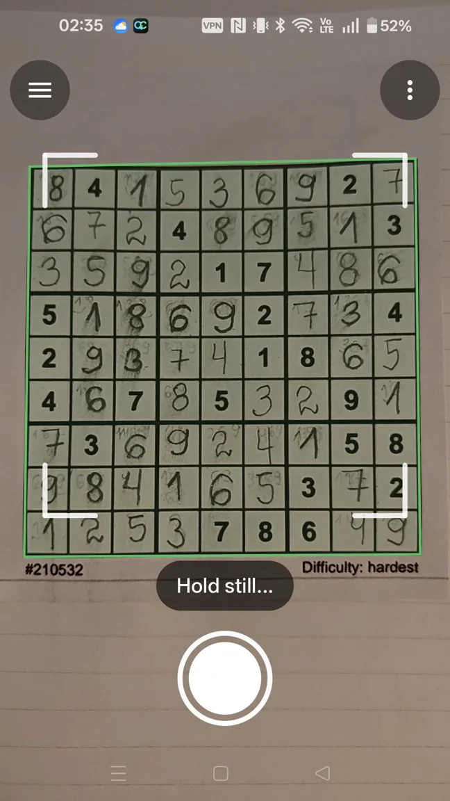
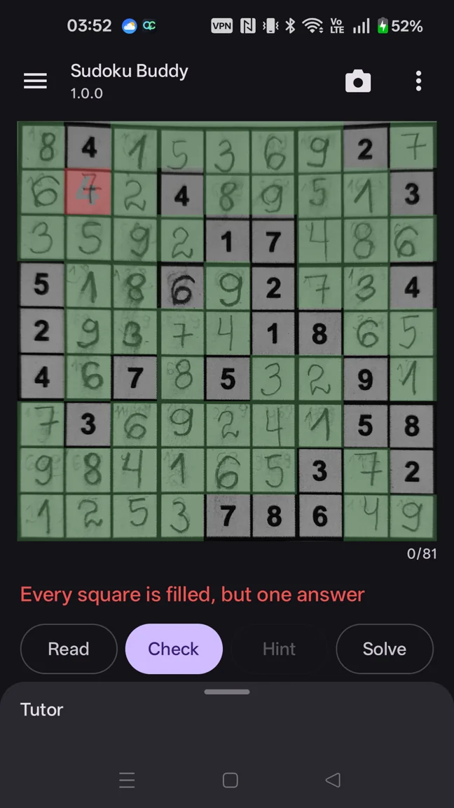
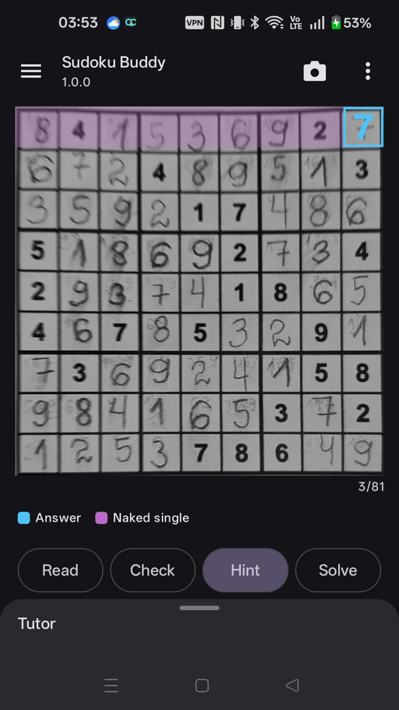

<p align="center"></p>

# Sudoku Buddy

**The joy is in figuring it out.**

Keep your pencil. Keep your puzzle. Get a little help when you need it.

Sudoku Buddy is an Android companion for standard 9×9 Sudoku on paper. Scan a
puzzle—including the answers you have already written—check the reading, and
ask for a hint that explains the next move. It is made to help with the puzzle
already on your page, not replace it.

[Website](https://freevia.org/sudoku-buddy/) ·
[Usage guide](docs/user-guide.md) ·
[Support](.github/SUPPORT.md) ·
[Privacy](https://freevia.org/sudoku-buddy/privacy)

## See the app

<p align="center">
  
  
  
</p>

These are real Android screens; the current release may differ slightly.
[See more on the website](https://freevia.org/sudoku-buddy/#screenshots).

## Get the app

**Google Play — Android:** [Get Sudoku Buddy](https://play.google.com/store/apps/details?id=org.freevia.sudokubuddy).
As of 1 November 2026, version 1.0.5 (code 244) is active in both Production and
Internal testing. The Play-installed build passed a physical camera check on a
OnePlus CPH2449: the user confirmed that all recognized clues matched a
known-valid printed Sudoku. The app needs Android 8.0+ and a camera. Invited
testers can use the
[internal-test opt-in](https://play.google.com/apps/internaltest/4701554944860354114).
No public APK is published in this repository.

## What it helps you do

- Read printed clues and handwritten progress, then correct a misread square.
- Check your answers and reveal a hint in stages, with the relevant cells and
  solving technique highlighted.
- Reopen saved puzzles from on-device history and continue after a break.

Scanning, checking and hints work on the phone, including offline. Handwriting,
erasures and lighting can cause misreads, so review the recognized grid before
relying on a check or hint.

## Support, feedback and bugs

[Get support](.github/SUPPORT.md) ·
[Share feedback](https://github.com/freevia-org/sudoku-buddy/issues/new?title=Suggestion%3A%20) ·
[Report a bug](https://github.com/freevia-org/sudoku-buddy/issues/new?title=Bug%3A%20)

GitHub issues and attachments are public. Remove personal details from reports
and use the private contact option in the support guide for a photograph or
example you do not want to post publicly.

## Privacy and release status

[Privacy policy](https://freevia.org/sudoku-buddy/privacy) ·
[Local-data deletion](https://freevia.org/sudoku-buddy/privacy#uninstalling)

Camera recognition and puzzle history stay on the device. Users can submit an
uncertain-reading report to Freevia for private recognition analysis and training; reports
include the puzzle photo, recognition results and corrections. Automatic sharing
is optional and off by default. The app has no account, ads, routine usage
analytics or ad tracking. See the [privacy policy](https://freevia.org/sudoku-buddy/privacy)
for report handling and deletion details.

Sudoku Buddy's original source code and documentation are licensed under
[Apache License 2.0](LICENSE). Freevia and Sudoku Buddy names and logos remain
subject to their respective trademark rights; the license does not grant branding
or endorsement rights. Third-party components retain their own licenses; see
[the notices](NOTICE) and [bundled license texts](app/src/main/assets/licenses).

## For contributors

The SwiftUI iOS port shares Kotlin recognition, solver and teaching logic, with
native scanning, durable history, localization and consent-based feedback. Open
`iosApp/SudokuBuddy.xcodeproj`; see [iOS development](docs/ios-preparation.md)
for setup and tests, and [App Store preparation](docs/app-store/README.md) for the submission packet and remaining account/device gates. The iOS preview supports
camera/photo scanning, manual entry, checking, hints, and on-device history with
automatic puzzle and progress restoration after restart. It also includes the
71 Android language catalogs, launcher artwork, offline notices, and Android
overlay colors in a dark SwiftUI interface. Review scanned cells
before play; the iOS capture path still needs validation on a physical iPhone.

The Android app uses Kotlin, Jetpack Compose, CameraX and OpenCV, with separate
modules for recognition and deterministic solving. Use JDK 21 and Android SDK
platform 36. From the repository root:

```powershell
.\gradlew.bat build
```

On macOS/Linux, use `./gradlew build`. The [usage guide](docs/user-guide.md)
and [Play preparation notes](docs/play-store.md) provide more
detail. A passing local build is not a Play release.
